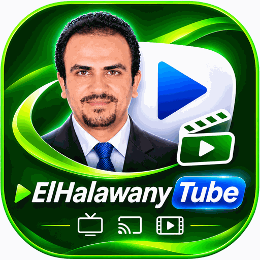
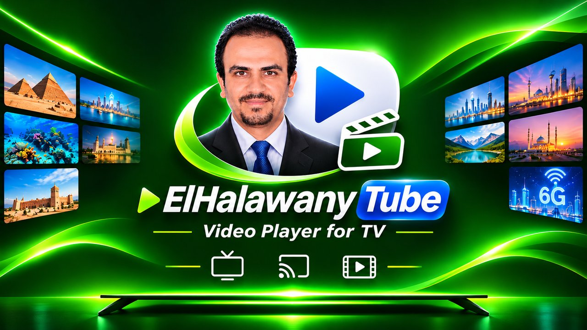

  

<h1 align="center">ElHalawany Tube</h1>

  Your YouTube channels on Android TV and car screens, with YouTube's official player.

  <a href="index.html">Home page</a> &nbsp;•&nbsp; <a href="privacy.html">Privacy policy</a> &nbsp;•&nbsp; <a href="terms.html">Terms of use</a>

  

## Apps

| App | Package | For |
|---|---|---|
| ElHalawany Tube for TV | `com.elhalawany.tube.tv` | Android TV / Google TV |
| ElHalawany Tube for Car | `com.elhalawany.tube.car` | Android car head units and tablets |

## Features

**TV:** family profiles; kids profiles with a parent PIN, allowed channels, daily time limit, allowed hours and a parent report; "new since your last visit"; Arabic interface and categories; send a video or playlist from your phone; venue mode (mosque, company, mall, cafe, restaurant).

**Car:** video next to a list of videos from your channels; big touch buttons; steering-wheel media buttons; "long trip" / "short ride" lists; voice commands; continue on the TV where you stopped in the car (and back).

## Google account and privacy

Signing in is optional. Scopes requested:

- `youtube.readonly`: read-only, to list subscriptions and playlists. Nothing on the account can be changed.
- `drive.file`: only files the app creates, for one "continue watching" file. No access to any other Drive file.

Everything else stays on the device. There is no developer server. Full details: [privacy policy](privacy.html).

ElHalawany Tube uses YouTube API Services and is not affiliated with YouTube or Google.

## Contact

basem.mamdoh@feng.bu.edu.eg
